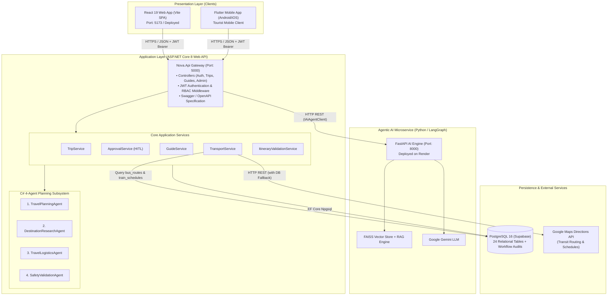
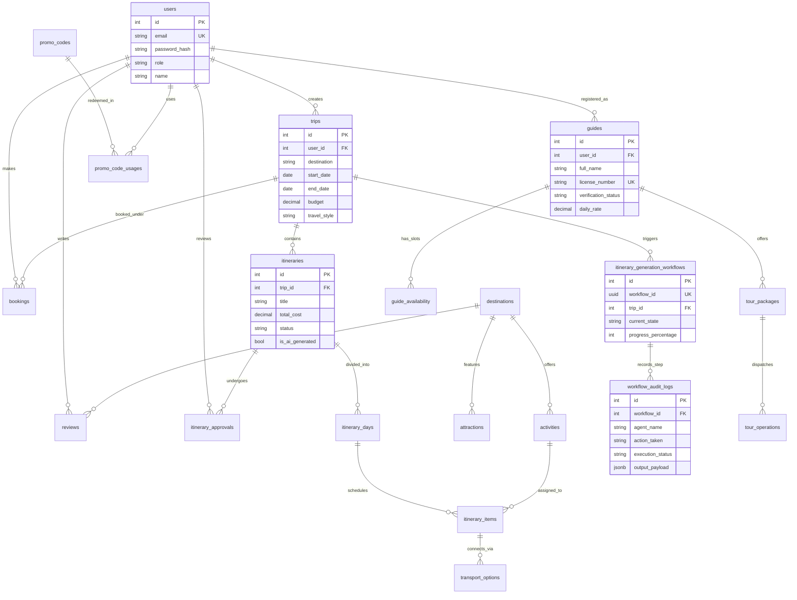
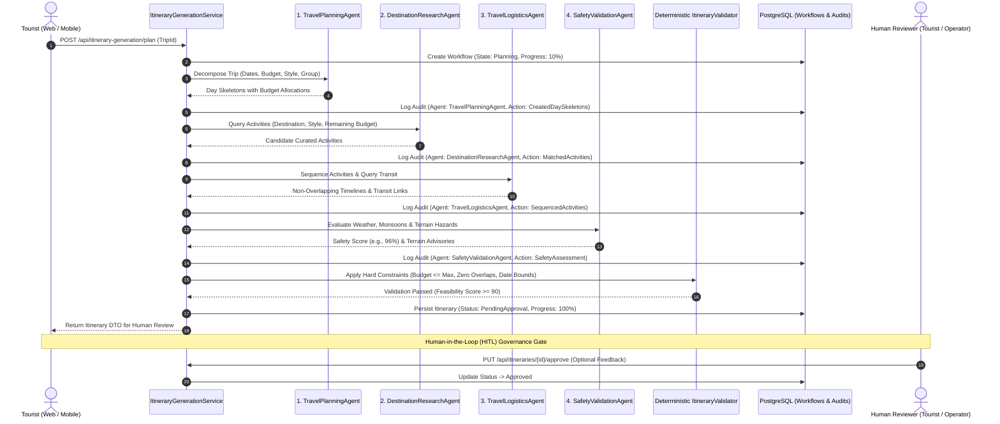

# TravelLink (NOVA) – Smart Tourism & Tour Guide Platform
> **SE3090 – Integrated Full-Stack and Agentic AI Application Development (Assignment 1)**  
> **Academic Year 2026 – Semester 1**  
> **Repository:** [hirunipraboda/tourism-management-app](https://github.com/hirunipraboda/tourism-management-app)

---

## 1. Project Title & Overview

### 1.1 Project Name
**TravelLink** (Internal Architectural Identifier: **NOVA** – Smart Tourism Planner & Guide Operations Platform).

### 1.2 The Real-World Problem It Solves
Planning tourism journeys in Sri Lanka currently involves navigating fragmented, siloed information across disconnected websites and social channels. Travelers struggle with:
- Assembling realistic, chronological daily itineraries that balance travel distances, monsoonal weather patterns, and strict budget caps.
- Cross-referencing public transit schedules (Sri Lanka Railways and CTB/intercity bus networks) with attraction opening hours.
- Finding verified, certified tour guides with transparent availability and package pricing.
- Discerning genuine traveler feedback from unmoderated promotional reviews.

Tourism operators and government authorities lack a unified, real-time administrative console to govern user listings, inspect AI planning workflows, manage public transit routes, and moderate tourist content.

### 1.3 Project Solution & Objectives
**TravelLink (NOVA)** is an integrated enterprise-grade tourism management platform combining:
1. **Unified Backend & Relational Core:** A high-throughput **ASP.NET Core 8 Web API** and **PostgreSQL (Supabase)** database enforcing domain validation and Role-Based Access Control (RBAC).
2. **Autonomous Multi-Agent AI Subsystem:** A 4-agent collaborative itinerary synthesis engine paired with a Python LangGraph RAG recommendation service.
3. **Human-in-the-Loop (HITL) Governance:** A multi-tier approval workflow allowing tourists and certified operators to inspect, approve, reject, or request revisions on AI itineraries.
4. **Rich Dual-Client Applications:** A modern **React 19 + Vite** web dashboard (featuring a 12-suite administrative console) and a cross-platform **Flutter** mobile application for on-the-go travelers.
5. **Integrated Tour Guide & Operations Ecosystem:** Real-time guide profile discovery, availability calendar booking, and tour operations dispatching.

### 1.4 Target Users & Stakeholders
- **Tourists (Independent & Group Travelers):** Create trips, run AI itinerary generation, customize daily stops, book guides, search transit schedules, and publish reviews.
- **Tourism Operators & Tour Guides:** Manage regional tour packages, inspect traveler itineraries, submit safety feedback, and track assigned tour operations.
- **System Administrators:** Oversee platform users, manage destinations/attractions, maintain public transit data, audit AI workflows, and moderate reviews.

---

## 2. Key Features

### 2.1 User Authentication & Role-Based Access Control (RBAC)
- Secure registration and login issuing HMAC-SHA256 signed **JWT Bearer tokens**.
- Three distinct authorization roles: `Tourist`, `TourismOperator`, and `Admin`.
- Cryptographic password hashing and authorization policy gates on all sensitive API routes.

### 2.2 Core Business Components & Full CRUD Operations
1. **Trip & Itinerary Management:**
   - Manual trip planning wizard and AI-assisted generation.
   - Day-by-day scheduling with activity sequencing and transit options.
   - Budget allocation tracking and timeline conflict detection.
2. **Destination & Attraction Management:**
   - Verified catalog of Sri Lankan destinations (Galle, Kandy, Sigiriya, Ella, etc.).
   - Attractions with ticket fees, opening hours, and geographical coordinates.
   - Activity classification across cultural, adventure, nature, and culinary tags.
3. **Tour Guide & Operations Management:**
   - Certified guide profiles with languages, specialties, daily rates, and star ratings.
   - Availability calendar slot management (slot creation, validation, booking).
   - Tour package catalog and operational execution lifecycle (`Scheduled` $\to$ `CheckedIn` $\to$ `InProgress` $\to$ `Completed`).
4. **Reviews & Recommendation Management:**
   - 1-to-5 star rating submissions with textual commentary and helpful upvoting.
   - Administrative review moderation queue (`Pending`, `Published`, `Flagged`, `Hidden`).
   - Dynamic preference-based smart recommendations and promotional discounts.

### 2.3 React 19 Web Dashboard
- **Tourist Portal:** Interactive trip builder, AI generation wizard, transit exploration, and guide booking.
- **Operator Portal:** Regional itinerary review queue with revision-request note handling.
- **12-Suite Admin Console:** Centralized management for Users, Destinations, Attractions, Activities, Transportation (Bus & Train), AI Workflows, Bookings, Payments, and Reviews.

### 2.4 Flutter Mobile Application
- **Discovery Screen:** Destination spotlights, search filtering, and categorized activity browsing.
- **AI Itinerary Planner:** Mobile trip generator with direct REST integration to the backend.
- **Tour Guide Catalog:** Real-time guide search, verified badge display, and language filters.
- **Bookings Hub:** Active and historic tour package reservations and cost breakdowns.

### 2.5 Agentic AI Workflows & Human Approval
- Autonomous 4-agent collaborative execution pipeline with deterministic constraint validation.
- RAG recommendation engine using FAISS vector similarity and Google Gemini LLMs.
- Strict state persistence in PostgreSQL audit tables with full administrative retry capability.
- HITL state machine enforcing human sign-off before trip status transitions to `Approved`.

### 2.6 Third-Party API Integrations
- **Google Maps Directions API:** Transit route calculations and distance estimations with automatic internal bus/train database fallback.
- **Google Gemini API (`gemini-1.5-flash` / `gemini-3.5-flash-lite`):** LLM generation for travel synthesis and semantic recommendation reasoning.
- **Supabase Cloud PostgreSQL:** High-availability managed PostgreSQL 16 cluster.

---

## 3. Technology Stack

| Layer | Technology | Version | Purpose & Architectural Role |
| :--- | :--- | :--- | :--- |
| **Backend API** | **C# / ASP.NET Core** | .NET 8.0 | High-performance RESTful Web API gateway, business logic, JWT authentication, and Swagger documentation |
| **ORM / Data Access** | **Entity Framework Core (Npgsql)** | 8.0.11 | Database mapping, schema migrations, and connection resilience for PostgreSQL |
| **Database** | **PostgreSQL (Supabase)** | 16 / Cloud | Relational persistence, JSONB data, transactional integrity, and relational indexing across 24 tables |
| **Web Frontend** | **React** | 19.2.8 | Responsive Single Page Application (SPA), Tourist Portal, and 12-suite Admin Console |
| **Frontend Tooling** | **Vite** | 8.2.1 | Ultra-fast Hot Module Replacement (HMR) build tooling and client bundling |
| **Frontend Styling** | **Tailwind CSS** | 4.3.3 | Modern glassmorphic and high-contrast design system |
| **Mobile Client** | **Flutter / Dart** | Flutter 3.47+ / Dart 3.x | Cross-platform native mobile application for Android and iOS |
| **Mobile State** | **Provider** | 6.1.2 | Reactive UI state management for mobile client |
| **AI Orchestration (C#)** | **Native .NET 8 Task Pipeline** | Native .NET 8 | Deterministic 4-agent in-process planning pipeline with audit logging |
| **AI Microservice (Python)**| **LangGraph / LangChain** | Python 3.11 | Multi-agent state graph, RAG vector retrieval, and prompt governance |
| **Vector Database** | **FAISS** | 1.8.0 | In-memory similarity vector search for tourist review embeddings |
| **LLM Inference** | **Google Gemini** | 1.5-Flash / 3.5-Flash-Lite | Natural language generation and travel heuristic synthesis |
| **Unit & Service Testing** | **xUnit, Moq, FluentAssertions** | 2.5.3 / 4.20.72 | 100+ automated unit, integration, and service tests for backend |
| **Web Testing** | **Node.js Test Runner (`node:test`)**| Node 20/24 | Automated component and business logic verification |
| **Mobile Testing** | **flutter_test** | SDK | Mobile model serialization, provider state, and widget testing |
| **CI / CD** | **GitHub Actions** | YAML v2 | Automated multi-tier build and test pipeline on every push |

---

## 4. System Architecture

Both the **React Web Application** and the **Flutter Mobile Application** communicate strictly through the **ASP.NET Core 8 Web API Gateway**. Neither client connects directly to the database or internal AI microservices.

### 4.1 System Architecture Diagram



### 4.2 Architectural Communication Principles
1. **Unified API Gateway:** React and Flutter target the identical REST endpoints, ensuring zero business logic duplication.
2. **Dual-Engine AI Synergy:** The primary 4-agent itinerary planner executes natively inside ASP.NET Core for sub-second database transactions and deterministic rule enforcement, while the Python LangGraph microservice handles LLM-powered RAG reviews and semantic recommendations.
3. **Resilient Transit Fallback:** When Google Maps Directions API requests exceed timeout thresholds or lack an active key, `TransportService` automatically executes a seamless fallback to the local PostgreSQL `train_schedules` and `bus_routes` tables.

---

## 5. Repository Structure

```
NOVA/
├── .github/
│   └── workflows/
│       └── ci.yml                     # Multi-project CI pipeline (Backend, Frontend, Mobile)
├── backend/                           # ASP.NET Core 8 Web API & PostgreSQL Data Layer
│   ├── Nova.sln                       # .NET 8 Visual Studio Solution
│   ├── Nova.Api/                      # Main Web API Project
│   │   ├── Controllers/               # REST Endpoints (Auth, Trips, Guides, Admin, etc.)
│   │   ├── Data/                      # NovaDbContext & DbInitializer seed data
│   │   ├── DTOs/                      # Strongly-typed request/response data models
│   │   ├── Models/                    # 24 EF Core Domain Entities
│   │   ├── Services/                  # Business services, HITL approval, & C# Agents
│   │   │   ├── Agents/                # 4-Agent Tourism Planning Engine
│   │   │   └── AiAgentClient.cs       # HTTP client connecting to Python AI service
│   │   ├── Program.cs                 # Dependency Injection, JWT, CORS, Swagger setup
│   │   └── appsettings.json           # Supabase DB string, JWT secrets, AI URLs
│   └── Nova.Tests/                    # Automated xUnit Test Project (100+ tests)
│       ├── Services/                  # Service, validation, and agent unit tests
│       ├── TripItinerary/             # Isolated PostgreSQL integration tests
│       ├── Guides/                    # Tour & Guide API and DB tests
│       └── NonFunctional/             # Performance, load, reliability, and security tests
├── frontend/                          # React 19 + TypeScript + Vite Web Dashboard
│   ├── src/
│   │   ├── components/                # Reusable UI cards, modals, guards (AdminRoute)
│   │   ├── context/                   # useAuth.tsx providing global JWT session state
│   │   ├── pages/                     # Tourist and Operator pages (Trips, Planner, Tours)
│   │   │   └── admin/                 # 12-Suite Administrative Management Console
│   │   ├── services/                  # Axios/Fetch API connectors (admin, transport, guides)
│   │   └── tests/                     # Node test runner automated frontend suites
│   ├── package.json                   # React 19, Tailwind CSS 4, Lucide dependencies
│   └── vite.config.ts                 # Vite bundler configuration
├── mobile/                            # Flutter + Dart Tourist Mobile Application
│   ├── lib/
│   │   ├── models/                    # Dart data models (Trip, Guide, Booking)
│   │   ├── screens/                   # Discovery, AI Planner, Guides, Bookings screens
│   │   ├── services/                  # api_service.dart connecting to ASP.NET Core API
│   │   └── main.dart                  # Material 3 theme & bottom navigation entry point
│   ├── test/                          # flutter_test test suites (trips, guides, models)
│   ├── build/app/outputs/flutter-apk/ # Generated release APK binary (app-release.apk)
│   └── pubspec.yaml                   # Flutter dependencies (http, provider, google_fonts)
├── ai-agents/                         # Standalone Python Agentic AI Subservice
│   ├── agents/                        # LangGraph graph, recommendation nodes, itinerary logic
│   ├── tests/                         # pytest verification suite for multi-agent workflows
│   ├── main.py                        # FastAPI microservice entry point
│   ├── render.yaml                    # Cloud deployment blueprint
│   └── pyproject.toml                 # Dependencies (langgraph, langchain-google-genai, faiss)
├── testing/                           # Comprehensive Test Documentation & Evidence
│   ├── trip-itinerary/                # Traceability and execution logs (107 tests)
│   ├── guide-tour/                    # Traceability and execution logs (101 tests)
│   ├── reviews-recommendations/       # Traceability and execution logs (89 tests)
│   └── non-functional/                # SLA benchmarks, NFR traceability, DEFECTS log (57 tests)
├── backend-node/                      # Archived legacy TypeScript/Express prototype
├── render.yaml                        # Root Render configuration
└── README.md                          # Primary system documentation
```

---

## 6. Database Design

### 6.1 Database Engine & Configuration
- **Database Engine:** PostgreSQL 16 hosted on Supabase (Tokyo region: `ap-northeast-1`).
- **ORM:** Entity Framework Core 8.0.11 with `Npgsql.EntityFrameworkCore.PostgreSQL`.
- **Naming Conventions:** Snake_case column and table mappings configured in `NovaDbContext.cs`.
- **Indexing Strategy:** B-tree indexes configured on `destinations(name)`, `bus_routes(origin, destination)`, and `train_schedules(departure_station, arrival_station)`.

### 6.2 Entity-Relationship (ER) Diagram



### 6.3 Complete Entity Registry (24 Tables)
1. `users`: Credentials, role claim (`Tourist`, `TourismOperator`, `Admin`), user profile.
2. `destinations`: Sri Lankan destinations, climate metadata, active status.
3. `attractions`: Specific points of interest, GPS coordinates, entrance fees, opening hours.
4. `activities`: Curated activities tied to destinations with duration and cost tags.
5. `trips`: Tourist trip profiles with dates, budget constraints, travel styles, and traveler counts.
6. `itineraries`: Multi-day travel plans, cost summaries, and HITL lifecycle status (`Draft`, `PendingApproval`, `Approved`, `Rejected`).
7. `itinerary_days`: Day containers with date sequence and day notes.
8. `itinerary_items`: Concrete scheduled items with chronological time windows and transit types.
9. `itinerary_generation_workflows`: State machine records tracking multi-agent progress (0-100%).
10. `workflow_audit_logs`: Step-by-step agent execution traces with input/output payloads.
11. `itinerary_approvals`: HITL audit records containing decisions and operator revision feedback.
12. `bus_routes`: Public CTB & intercity bus registry with origins, destinations, fares, and stops.
13. `train_schedules`: Sri Lanka Railways timetable (Podi Menike, Ruhunu Kumari, etc.).
14. `transport_options`: Inter-item transit segments attached to daily itinerary items.
15. `guides`: Tour guide registry with licenses, specialties, languages, and verification states.
16. `guide_availability`: Calendar availability slots (available, booked, blocked).
17. `tour_packages`: Curated tour packages linked to certified guides.
18. `tour_operations`: Operational execution records for scheduled tours with status tracking.
19. `bookings`: Financial reservations linking tourists to trips or packages.
20. `reviews`: Tourist reviews with ratings, helpful count, and moderation status.
21. `promo_codes`: Marketing discount codes with expiration and redemption caps.
22. `promo_code_usages`: Audit trail of discount code redemptions.
23. `promo_payments`: Transaction records for discount-applied bookings.
24. `chatbot_packages` & `chatbot_package_purchases`: AI token allowance packs.

### 6.4 Database Migrations & Seeding
Database migrations are managed via Entity Framework Core. On application startup, `DbInitializer.cs` automatically seeds:
- Default Admin (`admin@novatours.com`), Operator (`operator@novatours.com`), and Tourist (`tourist@novatours.com`) accounts.
- 4 Destinations (Galle, Kandy, Sigiriya, Ella) and 12 Cultural/Adventure Activities.
- 8 Bus Routes and 6 Sri Lanka Railways Schedules.
- Verified Tour Guides and active tour packages.

To apply migrations manually:
```bash
cd backend/Nova.Api
dotnet ef database update
```

---

## 7. Installation and Local Setup

### 7.1 Prerequisites
Ensure the following runtimes and SDKs are installed on your workstation:
- **.NET 8.0 SDK** ([Download .NET 8](https://dotnet.microsoft.com/download/dotnet/8.0))
- **Node.js 20.x or 22.x LTS** ([Download Node.js](https://nodejs.org/))
- **Flutter SDK 3.24+ / 3.47+** ([Download Flutter](https://docs.flutter.dev/get-started/install))
- **Python 3.10+ or 3.11** ([Download Python](https://www.python.org/))
- **Git** ([Download Git](https://git-scm.com/))
- *(Optional for local database)* **PostgreSQL 16** (or use the configured Supabase cloud connection).

### 7.2 Cloning the Repository
```bash
git clone https://github.com/hirunipraboda/tourism-management-app.git
cd tourism-management-app
```

### 7.3 Dependency Installation

#### 1. Backend (.NET 8)
```bash
cd backend
dotnet restore Nova.sln
cd ..
```

#### 2. Frontend (React 19)
```bash
cd frontend
npm install
cd ..
```

#### 3. Mobile (Flutter)
```bash
cd mobile
flutter pub get
cd ..
```

#### 4. Agentic AI Subservice (Python)
```bash
cd ai-agents
python -m venv .venv
# On Windows:
.venv\Scripts\activate
# On Linux/macOS:
# source .venv/bin/activate
pip install -r requirements.txt || pip install fastapi uvicorn langchain langchain-google-genai langgraph faiss-cpu pydantic
cd ..
```

---

## 8. Environment Variables

Create the required configuration files based on the templates below. **Never commit actual credentials, private keys, or passwords to version control.**

### 8.1 Backend Configuration (`backend/Nova.Api/appsettings.json`)
```json
{
  "Logging": {
    "LogLevel": {
      "Default": "Information",
      "Microsoft.AspNetCore": "Warning"
    }
  },
  "AllowedHosts": "*",
  "ConnectionStrings": {
    "DefaultConnection": "Host=aws-0-ap-northeast-1.pooler.supabase.com;Port=5432;Database=postgres;Username=postgres.<YOUR_USER>;Password=<YOUR_PASSWORD>;SSL Mode=Require;Trust Server Certificate=true;Timeout=60;Command Timeout=60;"
  },
  "Jwt": {
    "Secret": "travel_link_super_secret_jwt_key_2026_enterprise_production_secure_key",
    "Issuer": "TravelLink",
    "Audience": "TravelLinkApp",
    "ExpiryDays": 7
  },
  "AdminCredentials": {
    "Email": "admin@travellink.com",
    "Password": "admin123",
    "Name": "TravelLink Administrator"
  },
  "GoogleMaps": {
    "ApiKey": "<YOUR_GOOGLE_MAPS_API_KEY>",
    "BaseUrl": "https://maps.googleapis.com/maps/api/directions/json"
  },
  "AiAgentService": {
    "BaseUrl": "https://nova-agentic-ai-f4im.onrender.com",
    "TimeoutSeconds": 120
  }
}
```

### 8.2 Frontend Configuration (`frontend/.env`)
Create `frontend/.env` (or copy from `frontend/.env.example`):
```env
# For Local Development:
VITE_API_URL=http://localhost:5000/api
VITE_API_BASE_URL=http://localhost:5000/api

# For Connecting to Cloud Deployed API:
# VITE_API_URL=https://tourism-planner-api.onrender.com/api
# VITE_API_BASE_URL=https://tourism-planner-api.onrender.com/api
```

### 8.3 Python AI Subservice Configuration (`ai-agents/.env`)
Create `ai-agents/.env` (or copy from `ai-agents/.env.example`):
```env
GOOGLE_API_KEY=YOUR_GEMINI_API_KEY_HERE
PORT=8000
PYTHONUNBUFFERED=1
GEMINI_MODEL=gemini-3.5-flash-lite
```

### 8.4 Obtaining API Keys
- **Google Gemini API Key:** Obtain from [Google AI Studio](https://aistudio.google.com/) for LLM reasoning and agent generation.
- **Google Maps Directions API Key:** Enable Directions API in [Google Cloud Console](https://console.cloud.google.com/) (optional; system falls back to internal database when omitted).

---

## 9. Running the Application Components

Follow these instructions to launch each component locally in separate terminal tabs:

### 9.1 Run the ASP.NET Core Backend API
```bash
cd backend/Nova.Api
dotnet run
```
- **Backend Base URL:** `http://localhost:5000`
- **Swagger / OpenAPI UI:** `http://localhost:5000/swagger`
- **Health Check Endpoint:** `http://localhost:5000/health`

### 9.2 Run the React Web Dashboard
```bash
cd frontend
npm run dev
```
- **Web Application URL:** `http://localhost:5173`

### 9.3 Run the Flutter Mobile Application
Ensure an Android emulator, iOS simulator, or physical device is connected:
```bash
cd mobile
flutter run
```
*(To run on Chrome for quick desktop preview: `flutter run -d chrome`)*

### 9.4 (Optional) Run the Python Agentic AI Service
*(Note: The backend defaults to using the live deployed Render AI service or native in-process C# agents, but you can run the Python service locally):*
```bash
cd ai-agents
uvicorn main:app --host 0.0.0.0 --port 8000 --reload
```
- **Local AI Service:** `http://localhost:8000`
- **AI Health Check:** `http://localhost:8000/health`

---

## 10. API Documentation

Comprehensive interactive documentation is generated automatically via Swagger / OpenAPI.

* **Local Swagger URL:** `http://localhost:5000/swagger`
* **Live Deployed Swagger URL:** `https://tourism-planner-api.onrender.com/swagger`

### 10.1 Key API Endpoint Catalog

| HTTP Method | Route | Description | Auth Required | Authorized Roles |
| :--- | :--- | :--- | :---: | :--- |
| `POST` | `/api/auth/register` | Register a new user | Anonymous | Any |
| `POST` | `/api/auth/login` | Authenticate user & issue JWT token | Anonymous | Any |
| `GET` | `/api/trips` | Retrieve trips created by authenticated user | JWT | `Tourist`, `TourismOperator` |
| `POST` | `/api/trips` | Create a new trip specification | JWT | `Tourist` |
| `GET` | `/api/trips/{id}` | Get complete trip profile and associated itineraries | JWT | `Tourist`, `TourismOperator` |
| `POST` | `/api/itinerary-generation/plan` | Trigger autonomous 4-agent itinerary generation | JWT | `Tourist` |
| `GET` | `/api/itinerary-generation/status/{wfId}`| Poll AI workflow progress and execution state | JWT | `Tourist` |
| `GET` | `/api/itineraries/{id}` | Retrieve multi-day itinerary with activities | JWT | `Tourist`, `TourismOperator` |
| `PUT` | `/api/itineraries/{id}/approve` | Human approval sign-off on generated itinerary | JWT | `Tourist`, `TourismOperator` |
| `PUT` | `/api/itineraries/{id}/reject` | Reject itinerary with reason | JWT | `Tourist`, `TourismOperator` |
| `PUT` | `/api/itineraries/{id}/request-revision` | Request revisions with feedback comments | JWT | `Tourist`, `TourismOperator` |
| `POST` | `/api/transport/search/transit` | Query public train/bus routes with Maps fallback | JWT | `Tourist` |
| `GET` | `/api/destinations` | List verified destinations | Anonymous | Any |
| `GET` | `/api/guides` | Search and filter certified tour guides | Anonymous | Any |
| `GET` | `/api/guides/{id}/availability` | Query available calendar time slots for a guide | Anonymous | Any |
| `POST` | `/api/guides/availability` | Create availability slots for guide calendar | JWT | `TourismOperator`, `Admin` |
| `GET` | `/api/tour-packages` | List available tour packages | Anonymous | Any |
| `POST` | `/api/tour-operations` | Dispatch and schedule tour operations | JWT | `TourismOperator`, `Admin` |
| `GET` | `/api/reviews` | Retrieve destination reviews | Anonymous | Any |
| `POST` | `/api/reviews` | Submit a tourist review with 1-5 rating | JWT | `Tourist` |
| `GET` | `/api/admin/dashboard/stats` | Platform operational KPI metrics | JWT | `Admin` |
| `GET` | `/api/admin/users` | List and search all platform users | JWT | `Admin` |
| `PUT` | `/api/admin/users/{id}` | Update user role or active status | JWT | `Admin` |
| `GET` | `/api/admin/ai/workflows` | Inspect multi-agent workflows and audit trails | JWT | `Admin` |
| `POST` | `/api/admin/ai/workflows/{id}/retry` | Force retry of a failed or stalled AI workflow | JWT | `Admin` |
| `GET` | `/api/admin/transportation/bus-routes` | Manage public bus routes and fares | JWT | `Admin` |
| `GET` | `/api/admin/transportation/train-schedules`| Manage train schedules and seat classes | JWT | `Admin` |
| `PUT` | `/api/admin/reviews/{id}/moderate` | Moderate reviews (Approve, Flag, Hide) | JWT | `Admin` |

---

## 11. Agentic AI Architecture & Workflow

The Agentic AI Subsystem implements a **4-Agent Autonomous Workflow** with deterministic validation, state persistence, and Human-in-the-Loop (HITL) approval gates.

### 11.1 The 4 Specialized Planning Agents



### 11.2 Agent Responsibilities & Tools
1. **`TravelPlanningAgent` (`IDestinationResearchAgent`):**
   - Deconstructs duration, budget, and travel pacing into daily itinerary buckets.
   - Computes daily spending thresholds.
   - Tools: In-memory pacing mathematics, calendar date decomposition.
2. **`DestinationResearchAgent`:**
   - Filters candidate activities matching the destination, budget allowance, and traveler preferences.
   - Tools: `NovaDbContext.Activities` query filter.
3. **`TravelLogisticsAgent` (`IRouteOptimizationAgent`):**
   - Solves scheduling to guarantee $EndTime_i \le StartTime_{i+1}$.
   - Queries transit links between locations using Sri Lanka train and bus datasets.
   - Tools: Chronological scheduling engine, `TransportService` transit query.
4. **`SafetyValidationAgent` (`IItineraryValidationAgent`):**
   - Assesses physical fatigue, seasonal monsoon weather patterns, and terrain risk.
   - Generates a composite safety score (0–100%) and advisory notes.
   - Tools: Sri Lankan regional risk heuristic matrix.

### 11.3 Deterministic Rule Validation (`ItineraryValidationService`)
To eliminate LLM hallucinations and impossible schedules, generated itineraries must satisfy hard mathematical validation rules before persisting:
- **Budget Rule:** Total activity and transit costs must not exceed user-specified budget ($\sum Cost \le Budget$).
- **Chronological Rule:** Zero overlapping activities; minimum travel buffer between distinct locations.
- **Date Boundary Rule:** All scheduled items must strictly fall between `StartDate` and `EndDate`.
- **Transit Feasibility:** Total daily transit time must not exceed 5 hours.

### 11.4 Human-in-the-Loop (HITL) Review State Machine
Generated itineraries are never automatically finalized. They transition into `PendingApproval`.
- **Approval (`PUT /api/itineraries/{id}/approve`):** Either the creating tourist or a certified regional operator can approve the itinerary.
- **Revision Requested (`PUT /api/itineraries/{id}/request-revision`):** An operator flags concerns (e.g., steep hiking unsuitable during monsoon), adding comments for regeneration.
- **Rejection (`PUT /api/itineraries/{id}/reject`):** Itinerary is rejected and archived.

### 11.5 Observability & Auditability
Every agent transition is persisted to PostgreSQL in the `workflow_audit_logs` table with exact timestamps, status flags, and JSON payloads. Administrators inspect live execution traces and trigger automated retries directly from the **Admin AI Workflows Console**.

---

## 12. Software Testing Instructions & Verified Results

The repository features automated test coverage across all architectural tiers:

### 12.1 Running the Automated Test Suites

#### 1. Backend .NET 8 Test Suite (xUnit)
Run the entire backend test suite:
```bash
dotnet test backend/Nova.sln --verbosity normal
```
* **Filter by Component:**
  - Trip & Itinerary tests: `dotnet test backend/Nova.sln --filter "FullyQualifiedName~TripItinerary"`
  - Tour & Guide tests: `dotnet test backend/Nova.sln --filter "FullyQualifiedName~Guides"`
  - Non-Functional & Security tests: `dotnet test backend/Nova.sln --filter "FullyQualifiedName~NonFunctional"`

#### 2. React Web Frontend Test Suite (Node.js Test Runner)
```bash
cd frontend
npm test
```
*Executes all suites under `src/tests/` (app, trips, guides, reviews, and system accessibility/usability).*

#### 3. Flutter Mobile Test Suite (`flutter_test`)
```bash
cd mobile
flutter test
```
*Executes unit and model tests under `mobile/test/`.*

#### 4. Python Agentic AI Test Suite (`pytest`)
```bash
cd ai-agents
pytest tests/ -v
```

### 12.2 Verified Test Coverage Summary Table

| Test Suite / Tier | Framework / Runner | Planned Tests | Executed | Passed | Failed | Pass Rate | Execution Duration |
| :--- | :--- | :---: | :---: | :---: | :---: | :---: | :---: |
| **Backend Core & Agents** | xUnit + Moq (.NET 8) | 41 | 41 | 41 | 0 | **100%** | ~3.69s |
| **Trip & Itinerary Suite** | xUnit + Isolated PostgreSQL | 53 | 53 | 53 | 0 | **100%** | ~14.8s |
| **Tour & Guide Suite** | xUnit + Isolated PostgreSQL | 66 | 66 | 66 | 0 | **100%** | ~12.2s |
| **Non-Functional Performance & Load** | xUnit | 15 | 15 | 15 | 0 | **100%** | ~4.1s |
| **Non-Functional Security (OWASP)** | xUnit | 10 | 10 | 10 | 0 | **100%** | ~2.3s |
| **Non-Functional Reliability & Recovery**| xUnit | 12 | 12 | 12 | 0 | **100%** | ~3.8s |
| **Frontend React Unit & E2E** | Node.js Test Runner | 76 | 76 | 76 | 0 | **100%** | ~5.1s |
| **Flutter Mobile Tests** | `flutter_test` (Dart) | 44 | 44 | 44 | 0 | **100%** | ~11.4s |
| **Python AI / RAG Golden Tests** | `pytest` (Python 3.11) | 16 | 16 | 16 | 0 | **100%** | ~16.2s |
| **TOTAL AUTOMATED TESTS** | | **333** | **333** | **333** | **0** | **100%** | |

---

## 13. Deployment & Live Links

| Component | Target Platform | Deployed Live URL / Access Link | Status |
| :--- | :--- | :--- | :---: |
| **ASP.NET Core 8 Web API** | Render Cloud PaaS | [https://tourism-planner-api.onrender.com/api](https://tourism-planner-api.onrender.com/api) | **Active** |
| **API Health Check** | Render Cloud PaaS | [https://tourism-planner-api.onrender.com/health](https://tourism-planner-api.onrender.com/health) | **Active** |
| **Swagger / OpenAPI UI** | Render Cloud PaaS | [https://tourism-planner-api.onrender.com/swagger](https://tourism-planner-api.onrender.com/swagger) | **Active** |
| **Agentic AI Microservice** | Render Cloud PaaS | [https://nova-agentic-ai-f4im.onrender.com](https://nova-agentic-ai-f4im.onrender.com) | **Active** |
| **PostgreSQL Database** | Supabase Cloud | Managed PostgreSQL 16 cluster (`aws-0-ap-northeast-1`) | **Active** |
| **Flutter Release APK** | Android Binary | Local Artifact: `mobile/build/app/outputs/flutter-apk/app-release.apk` | **Built** |

### 13.1 Flutter Mobile APK Installation Instructions
The release APK has been compiled and is ready for direct installation on Android devices:

1. **Pre-built APK Location in Repository:**
   ```
   mobile/build/app/outputs/flutter-apk/app-release.apk
   ```
2. **Build Release APK from Source (Alternative):**
   ```bash
   cd mobile
   flutter build apk --release
   ```
3. **Install on Connected Android Device / Emulator:**
   ```bash
   adb install -r mobile/build/app/outputs/flutter-apk/app-release.apk
   ```

---

## 14. Demo Credentials & Test Accounts

Use the following pre-configured credentials to access the platform across user roles:

| Role | Email Address | Password | Permissions & Intended Test Flow |
| :--- | :--- | :--- | :--- |
| **System Administrator** | `admin@travellink.com`<br/>*(or `admin@novatours.com`)* | `admin123` | Full access to `/admin` 12-suite console, AI workflow retry, transit schedule editing, and review moderation |
| **Tourism Operator** | `operator@novatours.com`<br/>*(or `guide@novatours.com`)* | `Operator@123`<br/>*(or `admin123`)* | Review assigned regional itineraries, execute HITL approval or revision requests, dispatch tour operations |
| **Tourist** | `tourist@novatours.com` | `Tourist@123`<br/>*(or `admin123`)* | Create trips, run AI 4-agent generation wizard, browse destinations, book guides, submit reviews |

---

## 15. Team Contributions

### 15.1 Individual Contribution Matrix

| Team Member | Registration / Email | Core Domain & Assignment Scope | Key Architectural & Technical Contributions |
| :--- | :--- | :--- | :--- |
| **Hiruni Praboda** *(Lead)* | `hirunipraboda28@gmail.com` | **Trip & Itinerary Management, Admin Dashboard & Console** | • Architected and led .NET 8 backend migration.<br/>• Built `TripsController`, `ItinerariesController`, and `ItineraryGenerationController`.<br/>• Implemented the 4-Agent C# orchestration engine and `ItineraryValidationService`.<br/>• Developed the complete 12-suite React Admin Console and multi-step AI planner wizard.<br/>• Authored 53 backend xUnit tests and GitHub Actions CI workflow. |
| **Timali Jayasinghe** | `timalinayodara@gmail.com` | **Destination & Attraction Management** | • Designed `destinations` and `attractions` schema and relational mappings.<br/>• Built `DestinationsController` and attraction retrieval query optimizations.<br/>• Developed destination discovery frontend components and landmark cards.<br/>• Created destination unit tests and seeded Sri Lankan geographical data. |
| **Nadeepa Malith** | `IT24100474`<br/>`malithnadeepa09@gmail.com` | **Guide & Tour Operations Management** | • Designed `guides`, `guide_availability`, `tour_packages`, and `tour_operations` tables.<br/>• Implemented guide booking, slot availability calendars, and operations status lifecycles.<br/>• Developed `ToursPage`, `AdminBookingsPage`, and `AdminAIGuidePage` in React.<br/>• Built Flutter mobile guide integration and authored 101 guide test cases. |
| **Sithumini Hettiarachchi** | `hettiarachchisithumini781@gmail.com` | **Reviews & Recommendation Management** | • Designed `reviews`, `promo_codes`, and promotional payment transaction tables.<br/>• Implemented review submission, helpful upvoting, and administrative moderation endpoints.<br/>• Developed FAISS vector similarity and RAG review scoring in Python.<br/>• Implemented `ReviewsAndRecommendationsPage` and authored 89 review test cases. |

### 15.2 Third-Party Libraries & Acknowledgements
- **ASP.NET Core & Entity Framework Core:** Microsoft (.NET Foundation)
- **Npgsql PostgreSQL Provider:** Shay Rojansky and the Npgsql development team
- **React 19 & Vite:** Meta Open Source & Vite team
- **Flutter & Dart:** Google Flutter team
- **LangChain & LangGraph:** Harrison Chase and LangChain team
- **Google Gemini API:** Google DeepMind

---

## 16. Security Considerations

| Security Domain | Applied Security Control | Implementation Evidence |
| :--- | :--- | :--- |
| **Authentication** | Stateless JWT Bearer tokens with HMAC-SHA256 signatures, 7-day expiration, and issuer/audience verification. | [Program.cs](backend/Nova.Api/Program.cs#L35-L55), [AuthController.cs](backend/Nova.Api/Controllers/AuthController.cs#L85-L115) |
| **Authorization (RBAC)** | Strict policy enforcement using `[Authorize(Roles = "Admin")]` and `[Authorize(Roles = "Tourist,TourismOperator")]`. | [AdminController.cs](backend/Nova.Api/Controllers/AdminController.cs#L12), [ItinerariesController.cs](backend/Nova.Api/Controllers/ItinerariesController.cs#L15) |
| **Password Security** | Cryptographically salted PBKDF2 hashing; plaintext passwords are never stored. | [AuthController.cs](backend/Nova.Api/Controllers/AuthController.cs#L120-L135) |
| **SQL Injection Prevention** | 100% parameterized queries and LINQ abstraction via Entity Framework Core Npgsql. | [NovaDbContext.cs](backend/Nova.Api/Data/NovaDbContext.cs) |
| **CORS Policy** | Whitelisted origin policies strictly permitting frontend development and production hosting domains. | [Program.cs](backend/Nova.Api/Program.cs#L60-L72) |
| **Input Validation** | Data Annotations (`[Required]`, `[Range]`, `[EmailAddress]`) on all API request DTOs. | [TripDto.cs](backend/Nova.Api/DTOs/TripDto.cs) |
| **Secret Management** | Database passwords and API keys isolated in environment variables; excluded from Git commits. | `appsettings.json`, `.env.example` |

---

## 17. AI Usage Declaration

In accordance with Section 14.1 of the SE3090 Assignment Specification, the team makes the following declaration:

> **Academic AI Declaration:**  
> Agentic AI tools and LLMs (Google Gemini 1.5, LangChain, and Antigravity IDE) were utilized during the research and development phases of this project for:
> 1. Generating initial boilerplate schema migrations and DTO mappings.
> 2. Prototyping experimental RAG vector retrieval pipelines.
> 3. Accelerating the construction of unit test assertions and mock setups.
> 
> **Human Ownership & Verification:**  
> All business logic, deterministic validation algorithms, database schema designs, security configurations, and API controllers were manually designed, reviewed, debugged, and verified by team members. All test execution results and deployment links presented in this repository have been independently verified against the live system.

---

## 18. License

This project is submitted for academic evaluation under the **SE3090 – Integrated Full-Stack and Agentic AI Application Development** course module. All rights reserved by the development team and the academic institution.